<!-- Profil GitHub — Harouna MBAYE · Data Scientist & BI Analyst
     Visuels : SVG faits main (dossier assets/), animés, polices embarquées. -->

<a href="https://harouna-mbaye.netlify.app">
  <picture>
    <source media="(max-width: 600px)" srcset="assets/hero-m.svg" />
    
  </picture>
</a>

  &nbsp;
  &nbsp;
  &nbsp;
  

 

> **Data Scientist & BI Analyst** spécialisé en Intelligence Artificielle, je conçois des solutions data **de l'analyse jusqu'à leur intégration** dans des applications et environnements opérationnels.
> Mon mémoire de Master 2 porte sur l'**Explainable AI** appliquée à la détection d'anomalies en streaming.
> Basé à Dakar, je cherche un **poste en Data Science, Business Intelligence ou IA**.

 

<picture>
  <source media="(prefers-color-scheme: dark)" srcset="assets/h-apport-dark.svg" />
  
</picture>

<picture>
  <source media="(max-width: 600px)" srcset="assets/values-m.svg" />
  
</picture>

  

<picture>
  <source media="(prefers-color-scheme: dark)" srcset="assets/h-projets-dark.svg" />
  
</picture>

<a href="https://github.com/harounambaye/datavault2-ecommerce-fabric">
  <picture>
    <source media="(max-width: 600px)" srcset="assets/p-teranga-m.svg" />
    
  </picture>
</a>

<a href="https://github.com/harounambaye/datavault2-ecommerce-fabric"><b>Code source →</b></a>

<a href="https://esenguide.vercel.app">
  <picture>
    <source media="(max-width: 600px)" srcset="assets/p-esenguide-m.svg" />
    
  </picture>
</a>

<a href="https://esenguide.vercel.app"><b>Voir la démo →</b></a>

<a href="https://www.ceedrt.com">
  <picture>
    <source media="(max-width: 600px)" srcset="assets/p-ceedrt-m.svg" />
    
  </picture>
</a>

<a href="https://www.ceedrt.com"><b>Voir le site →</b></a>

<a href="https://github.com/harounambaye/ApacheStorm">
  <picture>
    <source media="(max-width: 600px)" srcset="assets/p-storm-m.svg" />
    
  </picture>
</a>

<a href="https://github.com/harounambaye/ApacheStorm"><b>Code source →</b></a>

<a href="https://www.prestigelavage.com">
  <picture>
    <source media="(max-width: 600px)" srcset="assets/p-prestige-m.svg" />
    
  </picture>
</a>

<a href="https://www.prestigelavage.com"><b>Voir le site →</b></a>

<picture>
  <source media="(max-width: 600px)" srcset="assets/p-archivedocpro-m.svg" />
  
</picture>

  

<a href="https://hmeducation.lovestoblog.com/gestionCoursEtSalles/index.html">
  <picture>
    <source media="(max-width: 600px)" srcset="assets/p-hmeducation-m.svg" />
    
  </picture>
</a>

<a href="https://hmeducation.lovestoblog.com/gestionCoursEtSalles/index.html"><b>Voir le site →</b></a>

<b>Autres réalisations</b> — labo data &amp; IA, applications web et mobile, réseau

 

**Labo data & IA**

| Projet | Ce qu'il montre | Stack |
|---|---|---|
| [SmartSensor ML](https://github.com/harounambaye/SmartSensor_SKL_ML) | Prédire l'état de capteurs IoT (OK / ALERTE / ERREUR) à partir de leurs mesures | scikit-learn · KNN |
| [Prédiction énergétique IoT](https://github.com/harounambaye/Tensorflow_Iot_Energy_Prediction) | Réseau de neurones (régression) pour la consommation d'un bâtiment | TensorFlow · Keras |
| [Avis clients](https://github.com/harounambaye/CustomerReviewPreprocessing) | Nettoyage et vectorisation de textes pour l'analyse de sentiments | NLP · Python |
| [Images de déchets](https://github.com/harounambaye/WasteImagePreprocessing) | Audit et préparation d'un dataset d'images pour la classification | Vision · Python |
| [Pipeline IoT](https://github.com/harounambaye/Iot_Data_Pipeline_Pandas) | Données de capteurs préparées pour la détection d'anomalies | Pandas |
| [AI Business Assistant](https://github.com/harounambaye/ai-business_assistant) | Conception progressive des prompts d'un assistant IA polyvalent | Prompt engineering |

**Applications & systèmes**

| Projet | Ce qu'il montre | Stack |
|---|---|---|
| [HMFOOD](https://hmfood.free.nf/omg_food/contenu/index.php) · [code](https://github.com/harounambaye/omg_food) | Commande et livraison pour la restauration | PHP · MySQL |
| [Gestion commerciale](https://github.com/harounambaye/GestionCommercialeJEE) | Stocks, produits, employés et salaires ; architecture multicouche | Java EE · EJB · PrimeFaces |
| Gestion des commandes Northwind | Double implémentation desktop / web, authentification via une API REST Java | WPF · ASP.NET · PostgreSQL · jBCrypt |
| [GestacheHM](https://github.com/harounambaye/GestacheHM) | Application mobile de gestion des tâches | Flutter · Dart |
| [Sécurité réseau pfSense](https://github.com/harounambaye/Pfsense) | Pare-feu : filtrage, gestion des flux, surveillance du trafic | pfSense |

 

<picture>
  <source media="(prefers-color-scheme: dark)" srcset="assets/h-recherche-dark.svg" />
  
</picture>

<picture>
  <source media="(max-width: 600px)" srcset="assets/thesis-m.svg" />
  
</picture>

  

<picture>
  <source media="(prefers-color-scheme: dark)" srcset="assets/h-parcours-dark.svg" />
  
</picture>

<picture>
  <source media="(max-width: 600px)" srcset="assets/timeline-m.svg" />
  
</picture>

  

<picture>
  <source media="(prefers-color-scheme: dark)" srcset="assets/h-stack-dark.svg" />
  
</picture>

<picture>
  <source media="(max-width: 600px)" srcset="assets/stack-m.svg" />
  
</picture>

Français (courant) · Pulaar (courant) · Anglais (intermédiaire, documentation technique) · Autorisation officielle d'enseigner dans les établissements privés du Sénégal

 

<a href="mailto:roonmbaye5@gmail.com">
  <picture>
    <source media="(max-width: 600px)" srcset="assets/footer-m.svg" />
    
  </picture>
</a>

  &nbsp;
  &nbsp;
  &nbsp;
  

